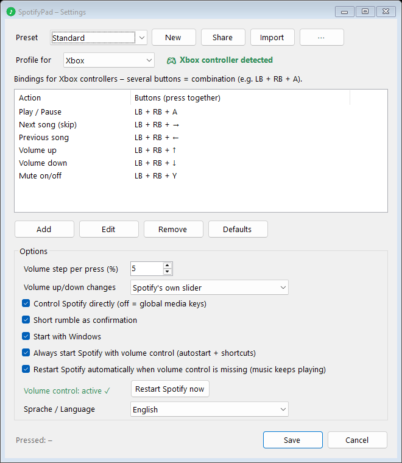

# SpotifyPad 🎮♪

**Control Spotify with your game controller – without leaving your game.**

Skip songs, pause and change Spotify's volume using button combinations on your Xbox or PlayStation controller. SpotifyPad runs quietly in the system tray, uses ~15 MB of RAM and practically no CPU, and never steals focus from your game.

<p align="center">
  
</p>

> 🇩🇪 Deutsche Kurzanleitung weiter unten – the app itself is available in **English and German**.

---

## Features

- **Play/Pause, Next, Previous, Volume up/down, Mute** – all from your controller
- **Button combinations** like `LB + RB + A` so you don't trigger things by accident while playing
- **Holding volume up/down** keeps changing the volume and speeds up the longer you hold
- **Moves Spotify's own volume slider** – your game volume stays untouched
- **No focus stealing** – works in fullscreen/borderless games
- **Xbox & PlayStation controllers** (DualShock 4, DualSense, DualSense Edge) with matching button names (`LB` / `L1`, `A` / `✕` …)
- **Separate bindings per controller type**, detected automatically
- **Presets** – multiple layouts, switch from the tray menu even while gaming
- **Share codes** – share your layout as a short text code; Xbox codes are automatically converted for PlayStation users and vice versa
- **Short rumble** as confirmation (Xbox controllers)
- **Starts with Windows** (optional) and makes sure Spotify starts with volume control
- **English & German** UI (follows your Windows language, or pick one)

## Download & setup

1. Download `SpotifyPad.exe` from the [**Releases**](../../releases) page. No installation needed.
2. Run it. Windows SmartScreen may warn you because the app isn't signed → click **More info** → **Run anyway**.
3. The settings window opens. Recommended:
   - ✅ **Start with Windows**
   - ✅ **Always start Spotify with volume control**
4. Click **Save**. Done – SpotifyPad now lives in your system tray (♪ icon, maybe behind the `^` arrow).

Double-click the tray icon to open the settings again. Right-click it for presets, pause and exit.

### Requirements

- Windows 10 or 11 (64-bit)
- The **Spotify desktop app from [spotify.com](https://www.spotify.com/download/)** (the Microsoft Store version is not supported)
- An Xbox controller, a PlayStation 4/5 controller, or a PC controller in XInput ("X") mode

## Default buttons

| Action | Xbox | PlayStation |
|---|---|---|
| Play / Pause | `LB + RB + A` | `L1 + R1 + ✕` |
| Next song | `LB + RB + →` | `L1 + R1 + →` |
| Previous song | `LB + RB + ←` | `L1 + R1 + ←` |
| Volume up | `LB + RB + ↑` | `L1 + R1 + ↑` |
| Volume down | `LB + RB + ↓` | `L1 + R1 + ↓` |
| Mute on/off | `LB + RB + Y` | `L1 + R1 + △` |

Change them in the settings: **Add** / **Edit** → **Record combination** → press the buttons together on your controller and let go.

> **Note:** Windows can't hide controller input from games, so your game also sees these buttons. That's why combinations are recommended.

## How it works

| Feature | How |
|---|---|
| Play / Pause / Skip | Sends media commands directly to the Spotify window (`WM_APPCOMMAND`) – no focus change |
| Spotify's volume slider | Spotify is built on Chromium. SpotifyPad starts Spotify with `--remote-debugging-port=9333` and moves the slider through the Chrome DevTools Protocol – no focus change |
| Fallback volume | If that port isn't available, SpotifyPad changes Spotify's entry in the Windows volume mixer instead |
| Controllers | Xbox via XInput, PlayStation via the Windows joystick API (winmm) |

If Spotify gets started without the debugging port (e.g. after a Spotify update), SpotifyPad restarts it automatically and resumes playback.

### ⚠️ Security note

The Chromium debugging port is **only reachable from your own PC** (`127.0.0.1`), not from the internet or your network. However, other programs running on your PC could use it to control Spotify while it's open. If that's a concern, set *Volume up/down changes* to **Spotify in the Windows mixer** and untick the two Spotify restart options.

## Where are settings stored?

`%APPDATA%\SpotifyPad\config.json` – delete it to reset everything. Autostart is a normal entry in `HKCU\Software\Microsoft\Windows\CurrentVersion\Run`.

## Build from source

Requires the [.NET 10 SDK](https://dotnet.microsoft.com/download).

```bash
git clone https://github.com/Bylxas/SpotifyPad.git
cd SpotifyPad
```

Small exe (needs the .NET 10 Desktop Runtime installed):

```bash
dotnet publish src/SpotifyPad/SpotifyPad.csproj -c Release -r win-x64 --self-contained false -p:PublishSingleFile=true -o publish
```

Standalone exe for sharing (~47 MB, runs on any 64-bit Windows 10/11):

```bash
dotnet publish src/SpotifyPad/SpotifyPad.csproj -c Release -r win-x64 --self-contained true -p:PublishSingleFile=true -p:IncludeNativeLibrariesForSelfExtract=true -p:EnableCompressionInSingleFile=true -o publish
```

### Project structure

```
src/SpotifyPad/
  Program.cs          Entry point, tray icon & menu, autostart
  Engine.cs           Controller polling, combo detection, action queue
  XInput.cs           Xbox (XInput) and PlayStation (winmm) input, button names
  SpotifyControl.cs   Play/pause/skip via WM_APPCOMMAND, mixer volume fallback
  SpotifyDevTools.cs  Volume slider via Chrome DevTools Protocol, Spotify launch flags
  SpotifyWatcher.cs   Restarts Spotify when volume control is missing
  Config.cs           Settings, presets, JSON storage
  ShareCode.cs        Preset share codes (JSON → Deflate → Base64url)
  SettingsForm.cs     Settings window
  BindingDialog.cs    Add/edit a binding, record combinations
  Prompt.cs           Small text input dialog
  Lang.cs             English/German UI texts
```

---

## 🇩🇪 Kurzanleitung (Deutsch)

**SpotifyPad steuert Spotify mit deinem Controller – ohne das Spiel zu verlassen.**

1. `SpotifyPad.exe` unter [**Releases**](../../releases) herunterladen und starten (keine Installation).
2. Bei der SmartScreen-Warnung: **Weitere Informationen** → **Trotzdem ausführen**.
3. Im Einstellungsfenster **„Mit Windows starten“** und **„Spotify immer mit Lautstärke-Steuerung starten“** anhaken → **Speichern**.

Standard-Tasten: `LB + RB` (bzw. `L1 + R1`) halten und dann `A`/`✕` = Pause, `→` / `←` = Skip / Zurück, `↑` / `↓` = Lauter / Leiser, `Y`/`△` = Stumm.
Eigene Belegungen, Presets und Teilen-Codes findest du in den Einstellungen. Die App-Sprache folgt deiner Windows-Sprache und lässt sich unter **Sprache / Language** umstellen.

---

## License

[MIT](LICENSE) – free to use, modify and share, as long as the copyright notice stays included.

*SpotifyPad is an independent project and is not affiliated with, endorsed or sponsored by Spotify AB, Microsoft or Sony.*
